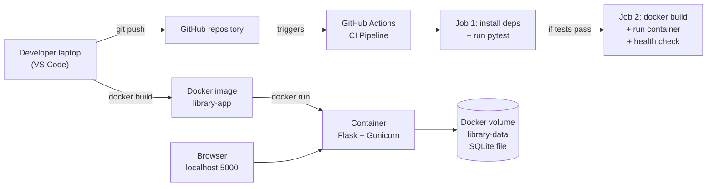

# Library Management System (Docker + GitHub Actions CI/CD)

A small Flask + SQLite web application for managing a library's books, packaged
with Docker and automatically tested and built by a GitHub Actions CI/CD pipeline.

## Features

- View all books with live counts of total, available and issued books
- Search books by title, author or ISBN
- Add a book with input validation (required fields, ISBN format, year range,
  duplicate ISBN check)
- View the details of a single book
- Issue a book to a borrower and mark it as returned
- Delete a book
- JSON API at `/api/books` and a health check at `/health`

## Technology Stack

| Purpose            | Technology               |
|--------------------|--------------------------|
| Web application    | Python 3.12, Flask       |
| Database           | SQLite (built into Python) |
| Frontend           | HTML (Jinja templates), CSS |
| Production server  | Gunicorn (inside Docker) |
| Automated tests    | pytest                   |
| Containerisation   | Docker                   |
| CI/CD              | GitHub Actions           |

## Architecture



## Project Structure

```
library-management-system/
├── .github/workflows/ci.yml   # CI/CD pipeline
├── static/style.css           # Styling
├── templates/                 # HTML pages
├── tests/test_app.py          # Automated tests
├── app.py                     # Flask application
├── Dockerfile                 # Docker image recipe
├── .dockerignore
├── .gitignore
├── pytest.ini
├── requirements.txt           # App dependencies
└── requirements-dev.txt       # App + test dependencies
```

## Run Locally with Python (Windows PowerShell)

```powershell
python -m venv .venv
.\.venv\Scripts\Activate.ps1
pip install -r requirements-dev.txt
python app.py
```

Open http://localhost:5000. Press `Ctrl+C` to stop.

## Run the Tests

```powershell
pytest
```

## Run with Docker

```powershell
docker build -t library-app .
docker run -d --name library-app -p 5000:5000 -v library-data:/app/data library-app
```

Open http://localhost:5000.

Useful commands:

```powershell
docker ps                      # list running containers
docker logs library-app        # view the application logs
docker stop library-app        # stop the container
docker start library-app       # start it again
docker rm -f library-app       # remove the container (data stays in the volume)
```

Book data is stored in the Docker volume `library-data`, so it survives container
restarts and re-creation. Running `docker volume rm library-data` deletes it.

## CI/CD Pipeline

The workflow in `.github/workflows/ci.yml` runs on every push and pull request
to the `main` branch, and can also be started manually from the **Actions** tab.

1. **Run automated tests** - installs Python 3.12 and the dependencies, then runs `pytest`.
2. **Build and test Docker image** - runs only if the tests pass. It builds the
   image, starts a container, waits for `/health` to return OK, checks the home
   page and API, prints the container logs and removes the container.

View results in the repository's **Actions** tab. A green tick means every step
passed; a red cross means a step failed. Click the run to read the logs.

## Environment Variables

| Variable           | Default                   | Purpose                              |
|--------------------|---------------------------|--------------------------------------|
| `DATABASE_PATH`    | `instance/library.db`     | Location of the SQLite database file |
| `SECRET_KEY`       | development-only value    | Signs flash-message cookies          |
| `SEED_SAMPLE_DATA` | `true`                    | Adds 3 sample books to an empty database |

The Docker image sets `DATABASE_PATH=/app/data/library.db`.
