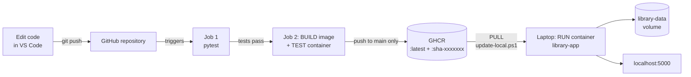

# Library Management System (Docker + GitHub Actions CI/CD)

A Flask + SQLite library dashboard, packaged with Docker. A GitHub Actions
pipeline tests every change, builds a Docker image, smoke-tests the running
container and publishes the tested image to GitHub Container Registry (GHCR).
The laptop then pulls that exact image and runs it.

## Features

- "Bunny Library" baby-pink theme with local SVG bunny mascots (`static/img/`), no external images
- Dashboard with live counts of total, available and on-loan books, plus the 4 most recently added books
- Book catalogue with search (title, author or ISBN) and status filters
- Add a book with validation (required fields, ISBN format, year range,
  duplicate ISBN check) and field-by-field error messages
- Book details page with issue, return and delete actions
- Responsive layout for laptops and phones
- JSON API at `/api/books` and a health check at `/health`
- The running version (for example `sha-3f9c2e1`) is shown in the sidebar and in `/health`

## Technology Stack

| Purpose            | Technology                               |
|--------------------|------------------------------------------|
| Web application    | Python 3.12, Flask                       |
| Database           | SQLite (file in a Docker volume)         |
| Frontend           | Jinja templates, plain CSS, a little JavaScript |
| Production server  | Gunicorn (inside Docker)                 |
| Automated tests    | pytest                                   |
| Containers         | Docker, Docker Compose (development)     |
| CI/CD              | GitHub Actions                           |
| Image registry     | GitHub Container Registry (ghcr.io)      |

## How the Automation Works



| Operation | Where it happens | Command |
|-----------|------------------|---------|
| Build an image | GitHub runner (or laptop with `-Build`) | `docker build` |
| Test the image | GitHub runner | `docker run` + `curl /health` |
| Publish the image | GitHub runner, push to `main` only | `docker push ghcr.io/...` |
| Pull the image | Your laptop | `docker pull` (done by `update-local.ps1`) |
| Run the image | Your laptop | `docker run` (done by `update-local.ps1`) |

GitHub Actions runs on GitHub's computers. It cannot change the containers on
your laptop. `scripts/update-local.ps1` is the step that brings the published
image to your laptop.

## Run It (Windows PowerShell)

Allow local scripts once (current user only):

```powershell
Set-ExecutionPolicy -ExecutionPolicy RemoteSigned -Scope CurrentUser
```

### Option 1: Run the latest tested image from GitHub

```powershell
.\scripts\update-local.ps1                     # pull the newest published image and run it
.\scripts\update-local.ps1 -Tag sha-1a2b3c4    # run one specific published version
.\scripts\update-local.ps1 -Watch              # keep checking and update automatically after each push
```

The swap is safe: the old container is stopped and kept aside until the new one
passes its `/health` check. If the new one fails, the old one is restored.

### Option 2: Development mode (see code changes instantly)

```powershell
.\scripts\dev.ps1          # start, then edit files and refresh the browser
.\scripts\dev.ps1 -Stop    # stop
```

`app.py`, `templates/` and `static/` are mounted into the container and Flask
reloads automatically, so you do not need to rebuild the image.

| You changed...                         | What you need to do                                |
|----------------------------------------|----------------------------------------------------|
| A template (`.html`), CSS or JS file   | Save, then refresh the browser                     |
| `app.py`                               | Save; Flask restarts itself in ~1 second, refresh  |
| `requirements.txt` or `Dockerfile`     | Run `.\scripts\dev.ps1` again (it rebuilds)        |

`dev.ps1` stops (but does not delete) the normal `library-app` container,
because only one container can use port 5000. After `.\scripts\dev.ps1 -Stop`,
bring it back with `docker start library-app`.

### Option 3: Build the image from your local code

```powershell
.\scripts\update-local.ps1 -Build
```

All three options use the same `library-data` volume, so your books are kept.
Only one runs at a time on http://localhost:5000, and the scripts switch
between them for you.

## Run Without Docker

```powershell
python -m venv .venv
.\.venv\Scripts\Activate.ps1
pip install -r requirements-dev.txt
python app.py      # http://127.0.0.1:5000
pytest             # run the automated tests
```

## Useful Docker Commands

```powershell
docker ps                                 # running containers
docker logs -f library-app                # follow the app logs
docker images                             # local images and tags
docker volume inspect library-data        # where the database lives
docker cp library-app:/app/data/library.db .\library-backup.db   # backup
```

Never run `docker volume rm library-data` unless you want to delete all books.

## CI/CD Pipeline

`.github/workflows/ci.yml` runs on every push and pull request to `main`, and
on demand from the **Actions** tab.

1. **Run automated tests**: installs Python 3.12 and dependencies, then runs `pytest`.
2. **Build, test and publish Docker image**: runs only if the tests pass.
   - Build: `docker build` with the version `sha-<commit>` stamped into the image.
   - Test: start the container, wait for `/health`, check the version, home page,
     API, add-book and detail pages, a 404 page, and that a new book is saved.
   - Publish: for pushes to `main` only, push `ghcr.io/<owner>/<repo>:sha-<commit>`
     and `:latest`. Pull requests are tested but never published.

Publishing uses the automatic `GITHUB_TOKEN`, so no passwords are stored anywhere.
After the first publish, open your GitHub profile > **Packages** >
`library-management-system` > **Package settings** > **Change visibility** > **Public**
so the laptop can pull it without logging in.

## Environment Variables

| Variable           | Default                | Purpose                                   |
|--------------------|------------------------|-------------------------------------------|
| `DATABASE_PATH`    | `instance/library.db`  | Location of the SQLite database file      |
| `SECRET_KEY`       | development-only value | Signs flash-message cookies               |
| `SEED_SAMPLE_DATA` | `true`                 | Adds 3 sample books to an empty database  |
| `APP_VERSION`      | `dev`                  | Version label (set automatically by CI)   |
| `BUILD_DATE`       | empty                  | Build time label (set automatically by CI)|

The Docker image sets `DATABASE_PATH=/app/data/library.db`.
